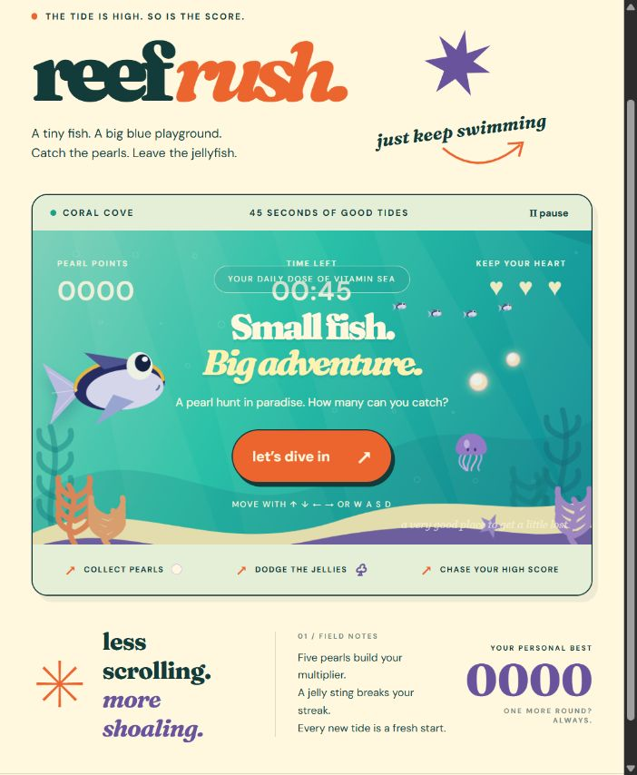

# Reef Rush

A tropical fish arcade game and repository-repair test case. Collect pearls, dodge jellyfish, and chase a high score in 45 seconds.



## Two versions

| Folder | Purpose | Test results | Default preview |
| --- | --- | --- | --- |
| [`buggy/`](buggy/) | Deliberately buggy repair challenge | 7 failing, 5 passing | http://localhost:4176 |
| [`fixed/`](fixed/) | Fixed reference implementation | All 12 passing | http://localhost:4175 |

Both versions use identical artwork, UI, and regression tests. Gameplay differences are confined to `src/engine.js`. They run independently with Node.js 20+ and require no dependency installation or API keys.

## Play

```sh
cd buggy
npm start
```

Or run `cd fixed` followed by `npm start` for the corrected version. Use arrow keys, WASD, or touch controls. Press P or Escape to pause.

## Test

Inside either folder:

```sh
npm test
```

The intentionally broken version has defects in duplicate collection, damage immunity, pausing, frame-dependent movement, diagonal speed, boundary handling, and restarting. See each folder's `GAME_RULES.md` for required behavior.

## Use as a repair benchmark

Give the repair model only the `buggy/` folder and ask it to fix the implementation without modifying tests or visual design. Keep `fixed/` out of the model's accessible files because it contains the answer key. These are deterministic failing tests, not intermittent failures.
